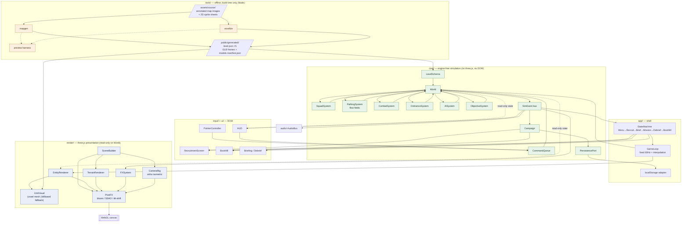
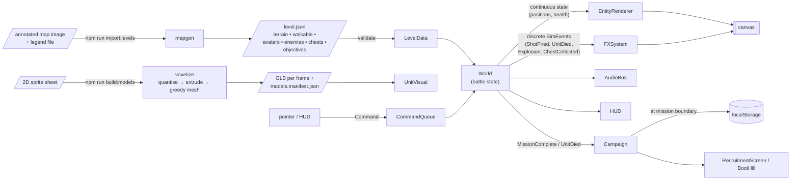
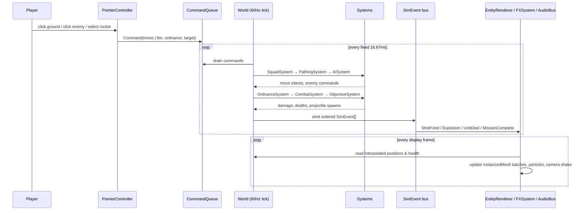
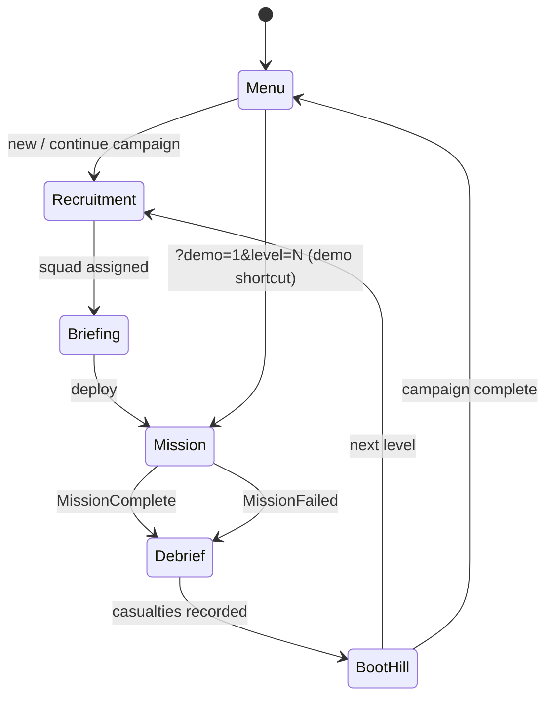
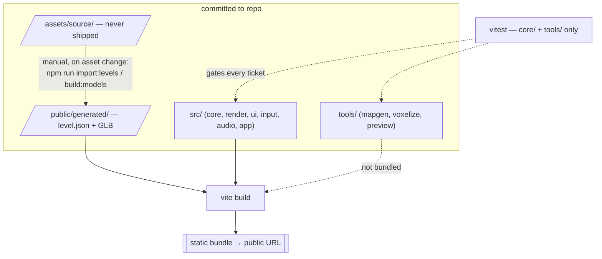

# Architecture Diagram — Game Week: Cannon Fodder Remake

Component names match `ARCHITECTURE.md` exactly.

## Component / interaction diagram

Green = pure, unit-tested logic. Blue = rendering (untested by design). Amber = offline tooling.

## Data flow

## Mission tick — sequence

## Campaign / screen state machine

## Build & deploy boundary

